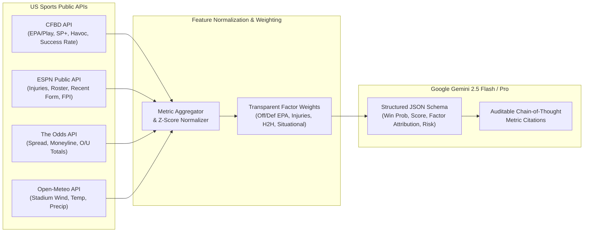

# US Sports & College Football (NCAAF) Public API Catalog & LLM Integration Guide

This reference details the public and freemium US Sports APIs—with deep specialization in **NCAA Division I College Football (FBS/FCS)** alongside major US leagues (NFL, NBA, MLB, NHL)—and explains how each endpoint feeds into the **GridironIQ Android Application** and its **Google Gemini LLM Reasoning Engine**.

---

## 1. Primary College Football & US Sports Public APIs

| API Provider | Primary Coverage | Auth Requirement | Free Tier / Rate Limit | Key Data Provided for LLM |
| :--- | :--- | :--- | :--- | :--- |
| **CollegeFootballData API (CFBD)** | NCAAF (FBS, FCS, DII, DIII) | Free Bearer API Key | 30,000+ calls/mo (Patreon/Free) | EPA/play, SP+ ratings, Elo, FPI, Returning Production, Recruiting, Drives, Play-by-Play, Coaching records |
| **ESPN Hidden Public API** | NCAAF, NFL, NBA, MLB, NHL, NCAAB | **None (No Key Needed)** | Public CDN (Unmetered fair use) | Live Scoreboard, Win Probability, Injury Reports, Rosters, Box Scores, AP/CFP Rankings, Venue/Weather |
| **NCAA Data API (HenryGD / NCAA.com)** | All NCAA Sports | **None (Public JSON)** | 5 req/sec per IP | Official NCAA brackets, live scores, team standings, game-by-game stats |
| **The Odds API** | NCAAF, NFL, NBA, MLB, NHL | Free API Key | 500 req/month free | Real-time Moneyline, Point Spreads, Totals (O/U) across DraftKings, FanDuel, BetMGM, Caesars |
| **Open-Meteo Weather API** | Global Stadium Coordinates | **None (No Key Needed)** | 10,000 req/day free | Kickoff temperature, wind speed/gusts (mph), precipitation probability, humidity at stadium GPS |
| **TheSportsDB** | US & Global Sports | Free Key (`3` or `123`) | 100 req/min | Team badges, stadium photos, historical matchups, jersey colors |
| **BallDontLie (NCAAF / NFL / NBA)** | NCAAF, NFL, NBA, MLB | Free API Key | 5–60 req/min | Player season stats, game logs, active rosters, standings |
| **Sportradar / SportsDataIO** | Enterprise US Sports | Trial / Commercial Key | 1,000 trial calls | Official league injury feeds, depth charts, player props, live play-by-play |

---

## 2. Endpoint-by-Endpoint Breakdown & Live URLs

### A. ESPN Public API (Zero-Config, Live in App)
ESPN's public site API requires **no API key** and supports CORS directly from mobile and web clients:

- **Live College Football Scoreboard & Rankings**
  `https://site.api.espn.com/apis/site/v2/sports/football/college-football/scoreboard?groups=80&limit=50`
  *(Note: `groups=80` filters to FBS; `groups=81` filters to FCS)*
- **Detailed Match Summary, Box Score, Injuries, Win Probability & Predictor**
  `https://site.api.espn.com/apis/site/v2/sports/football/college-football/summary?event={EVENT_ID}`
- **AP Top 25 & College Football Playoff (CFP) Rankings**
  `https://site.api.espn.com/apis/site/v2/sports/football/college-football/rankings`
- **Team Details, Roster & Schedule**
  `https://site.api.espn.com/apis/site/v2/sports/football/college-football/teams/{TEAM_ID}`

> [!TIP]
> The ESPN `/summary?event={EVENT_ID}` endpoint returns `predictor` (ESPN FPI pre-game win probability), `injuries` (player-by-player status: *Out*, *Doubtful*, *Questionable*), `leaders` (passing/rushing/receiving), `boxscore` (3rd down efficiency, turnovers, yards per play), and `gameInfo.weather`.

### B. CollegeFootballData.com (CFBD) API v2 (Advanced Sabermetrics)
Base URL: `https://api.collegefootballdata.com` (Header: `Authorization: Bearer <CFBD_API_KEY>`)

- **SP+ & SRS Ratings**: `GET /ratings/sp?year=2026` & `GET /ratings/srs?year=2026`
- **Elo & FPI Ratings**: `GET /ratings/elo?year=2026` & `GET /ratings/fpi?year=2026`
- **Advanced Season Metrics (EPA, Success Rate, Explosiveness, Havoc)**:
  `GET /stats/season/advanced?year=2026&team={TEAM_NAME}`
- **Pregame Win Probability & Spread**:
  `GET /metrics/wp/pregame?year=2026&week={WEEK}`
- **Head-to-Head Matchup History**:
  `GET /teams/matchup?team1={TEAM_1}&team2={TEAM_2}`
- **Returning Production (PPA / Usage)**:
  `GET /player/returning?year=2026&team={TEAM_NAME}`

### C. The Odds API v4 (Market Consensus & Sharp Action)
Base URL: `https://api.the-odds-api.com/v4/sports/americanfootball_ncaaf/odds`
- Query params: `?regions=us&markets=h2h,spreads,totals&oddsFormat=american&apiKey={ODDS_API_KEY}`
- Provides implied market win probability ($P_{\text{implied}} = \frac{|\text{ML}|}{|\text{ML}| + 100}$ for favorites) to compare against the LLM's statistical model edge.

### D. Open-Meteo Stadium Weather API (Zero-Config)
Base URL: `https://api.open-meteo.com/v1/forecast`
- Query params: `?latitude={STADIUM_LAT}&longitude={STADIUM_LON}&hourly=temperature_2m,precipitation_probability,wind_speed_10m,wind_gusts_10m&temperature_unit=fahrenheit&wind_speed_unit=mph`
- Crucial for outdoor NCAAF stadiums (e.g., Michigan Stadium, Beaver Stadium, Lambeau/Camp Randall) where winds $>15\text{ mph}$ reduce deep passing completion rates by ~18% and field goal accuracy by ~22%.

---

## 3. How the Metrics Feed the Google Gemini LLM Prediction Engine

### Transparent Multi-Factor Attribution Model
To ensure you can see **exactly how the LLM chooses the winner**, the app feeds a normalized JSON feature vector into **Google Gemini (`gemini-2.5-flash`)** with `responseSchema` enforcement, requiring the model to output:
1. **Predicted Winner & Win Probability** ($0\text{--}100\%$) + Confidence Tier (*High / Moderate / Toss-Up*).
2. **Projected Final Score** & Point Margin vs. Market Spread.
3. **Quantified Factor Contributions** (signed percentage points showing how much each metric shifted the win probability toward the Away or Home team):
   - **Offensive & Defensive Efficiency (EPA/Play & SP+)**: Default weight $30\%$
   - **Quarterback & Key Starter Injury Impact**: Default weight $25\%$
   - **Trench Warfare (Line Yards, Sack/Havoc Rate, 3rd Down %)**: Default weight $15\%$
   - **Turnover Margin & Red Zone TD Efficiency**: Default weight $15\%$
   - **Situational, Home Field, Travel & Stadium Weather**: Default weight $15\%$
4. **Verifiable Metric Citations**: Every paragraph in the LLM's explanation cites the exact API source and metric value (e.g., `[CFBD: +0.24 Off EPA/play]`, `[ESPN Injury: Starting LT Questionable]`).
